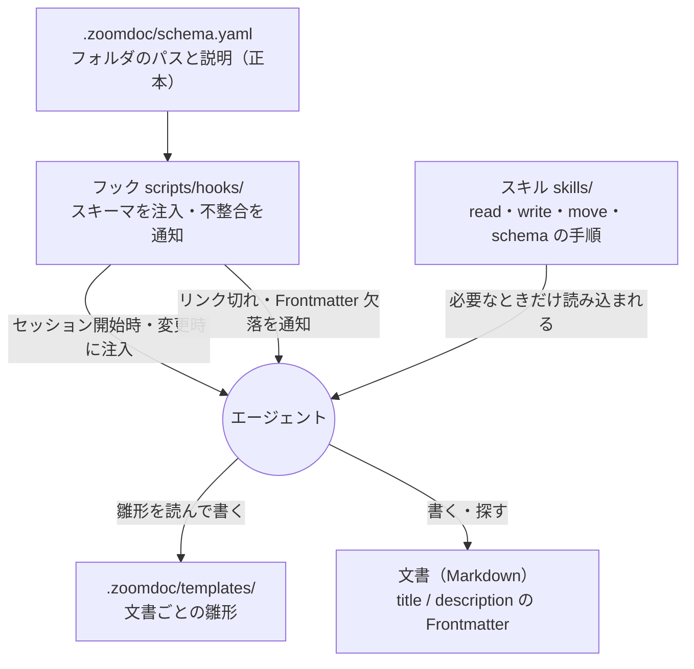

# システム全体アーキテクチャ設計

エージェントが、残すべき文書を確実に残し、必要な文書を最小のコストで見つけられるようにする。道具は増やさず、**スキーマ（宣言）・フック（想起と検知）・スキル（手順）** の3つだけで構成する。

## 1. 構成

## 2. 各要素の責務

1. **スキーマ**: 何を・どこに・どう残すかの宣言。フォルダのパスと、フォルダの説明、置く文書の行（`name`・`description`・`create`・`update`・`template`・`remove`）を持つ。値は自然文。機械が確かめるのは、パスと、必須の欄が埋まっているかだけ。
2. **フック**: スキーマを確実に読ませることと、不整合の通知だけを担う。書き込まない。
   - `sync-triggers`: セッション開始時とスキーマ変更時に、スキーマをそのまま注入する。
   - `detect-issues`: リンク切れ、Frontmatter の欠落、スキーマの置き場の外にある文書とサブディレクトリ、同じフォルダの title の重複、スキーマが参照する雛形の欠落を、あるべき状態と現状の形で通知する。
3. **スキル**: 普段はコンテキストに入らず、必要なときだけ読まれる手順。探索は、`title` と `description` を一覧するコマンドで、本文を開く前に絞る。
4. **文書とテンプレート**: Git 管理される Markdown が唯一の正本。索引・キャッシュは持たない。

## 3. 設計の根拠

- 周辺ツール（サーバー、索引、同期）は、管理コストが価値を上回った。エージェントは、慣れたツール（`ls`、`cat`、`sed`）を選びがちで、専用ツールは使われない回が多かった。
- 文書は多くて数十件の想定なので、スキーマを要約せず、そのまま注入しても軽い。注入は、セッション開始時と変更時の1回に限る。
- 移行（`migrate.js`）は、大量の移動とリンクの書き換えを確実に行うため、コードで持つ。1回きりの作業で、承認・ログ・ロールバックを備える。
